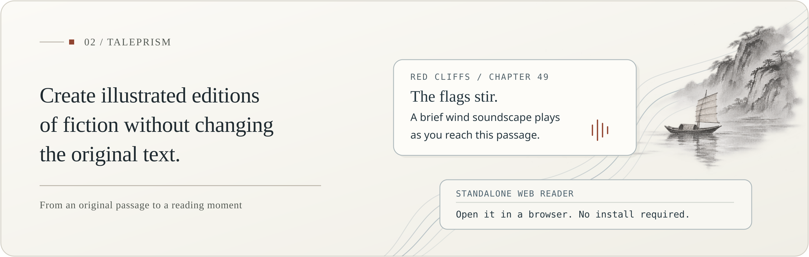

<strong>English</strong> · <a href="README.zh-CN.md">简体中文</a>

# Open projects

## 01 · [Code2KB Agent Toolkit](https://github.com/Ethereal-Space-one/code2kb-agent-toolkit)

Give your existing AI coding assistant a module and a pinned revision. Code2KB helps it extract business logic, including workflows, conditions, and exceptions, and ties the resulting knowledge to source evidence. After review, the toolkit publishes a business edition for readers and Q&A systems, and an engineering edition with implementation details and source references. It prepares the knowledge; it doesn’t run the chatbot.

[See a sample Q&A](https://github.com/Ethereal-Space-one/code2kb-agent-toolkit/blob/62f3012dc5380918efec38e4114e24e231a6e211/conformance/english/knowledge.md) · [Explore the toolkit](https://github.com/Ethereal-Space-one/code2kb-agent-toolkit) · [Quick start](https://github.com/Ethereal-Space-one/code2kb-agent-toolkit/blob/main/README.en.md#quick-start) · [v2.4.1 release](https://github.com/Ethereal-Space-one/code2kb-agent-toolkit/releases/tag/v2.4.1)

## 02 · [Taleprism](https://github.com/Ethereal-Space-one/taleprism)

A local workbench for creating illustrated editions of fiction without rewriting the original text. Authors place illustrations, sound, and subtle motion at specific passages, then export a reader that opens in the browser without installation. In *Red Cliffs*, maps and allegiances unfold as you read; a brief soundscape brings wind to the passage where the flags stir.

[Read *Red Cliffs* online](https://ethereal-space-one.github.io/taleprism/) · [Read *The Door Left Open* offline](https://github.com/Ethereal-Space-one/taleprism/releases/download/v0.9.2/taleprism-v0.9.2-the-door-left-open-reader.zip) · [Explore Taleprism](https://github.com/Ethereal-Space-one/taleprism)

### Also on the workbench

<table width="100%">
<tr>
<td width="50%" valign="top">

<strong>03 · <a href="https://github.com/Ethereal-Space-one/grid-browser">Grid Browser</a></strong> 
Compare sources and save your judgement with citations. 
<a href="https://github.com/Ethereal-Space-one/grid-browser/blob/release/v0.2.1/docs/TRY_GRID_0.2.1.md">Preview guide</a> · <a href="https://github.com/Ethereal-Space-one/grid-browser/blob/main/PLAN.md">Product direction</a>
</td>
<td width="50%" valign="top">

<strong>04 · <a href="https://github.com/Ethereal-Space-one/long-task-runbook">Long Task Runbook</a></strong> 
Hand off work and resume from verified checkpoints. 
<a href="https://github.com/Ethereal-Space-one/long-task-runbook/blob/main/skills/long-task-runbook/SKILL.md">Read the skill</a> · <a href="https://github.com/Ethereal-Space-one/long-task-runbook/releases/latest">Download</a>
</td>
</tr>
</table>

[All public repositories](https://github.com/Ethereal-Space-one?tab=repositories) · [Source for this page](https://github.com/Ethereal-Space-one/Ethereal-Space-one)
