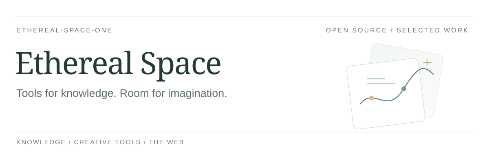
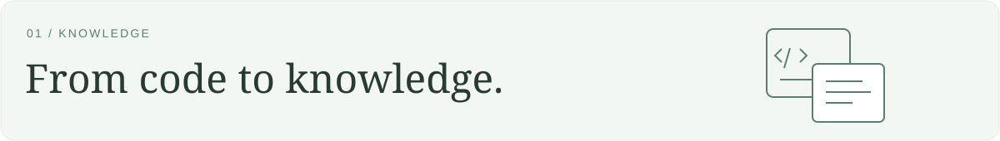
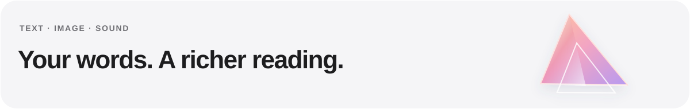
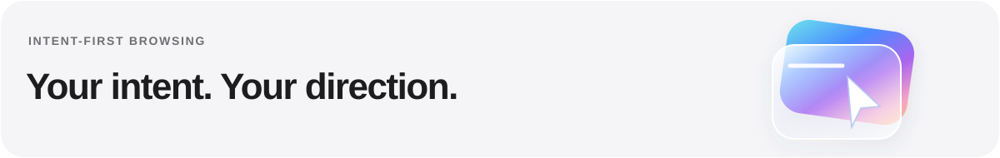

<strong>English</strong> · <a href="README.zh-CN.md">简体中文</a>

I build open tools for **knowledge, creativity, and a more personal web**.

My projects explore how AI can help us understand code, bring stories into view, and navigate the web with intent.

 

## Selected work

### [code2kb-agent-toolkit](https://github.com/Ethereal-Space-one/code2kb-agent-toolkit)

Turn business rules in source code into **traceable, maintainable knowledge** with your existing AI coding assistant.

[Explore the toolkit ↗](https://github.com/Ethereal-Space-one/code2kb-agent-toolkit) · [Getting started](https://github.com/Ethereal-Space-one/code2kb-agent-toolkit#快速开始)

 

### [Taleprism](https://github.com/Ethereal-Space-one/taleprism)

An illustrated-fiction workflow that **keeps the original text** and brings characters and scenes into a continuous reading experience. Public preview.

[Read the Chibi showcase ↗](https://ethereal-space-one.github.io/taleprism/) · [Explore the project](https://github.com/Ethereal-Space-one/taleprism)

 

### [Grid Browser](https://github.com/Ethereal-Space-one/grid-browser)

A browser experiment focused on **finding, understanding, and using real webpages**, with people in control. Not yet a daily-use browser.

[Explore the experiment ↗](https://github.com/Ethereal-Space-one/grid-browser) · [Product direction](https://github.com/Ethereal-Space-one/grid-browser/blob/main/PLAN.md)

 

## Threads I’m exploring

**Source-grounded knowledge** · **Visual storytelling** · **Human–AI collaboration**

For project questions, ideas, or feedback, start with the linked repositories.
