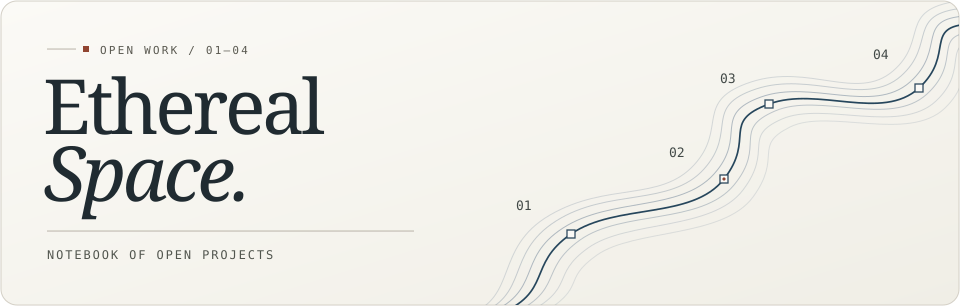

<strong>English</strong> · <a href="README.zh-CN.md">简体中文</a>

# I make tools for reading things more closely.

Read code back to the decisions it contains. Read fiction without losing the words. Find the page you meant to find, and keep your place when a long job stops.

## 01　Code2KB Agent Toolkit

**Turn the business logic in source code into knowledge a chatbot can retrieve and people can verify.** Your coding assistant extracts and writes; Code2KB checks evidence and review state before packaging the result. It leaves indexing and chatbot deployment to you.

[See a sample Q&A](https://github.com/Ethereal-Space-one/code2kb-agent-toolkit/blob/62f3012dc5380918efec38e4114e24e231a6e211/conformance/english/knowledge.md) · [Explore the toolkit](https://github.com/Ethereal-Space-one/code2kb-agent-toolkit) · [Quick start](https://github.com/Ethereal-Space-one/code2kb-agent-toolkit/blob/main/README.en.md#quick-start) · [v2.4.1 release](https://github.com/Ethereal-Space-one/code2kb-agent-toolkit/releases/tag/v2.4.1)

## 02　Taleprism

**Keep every word. Let a scene have its sound.** Taleprism is a local workbench for making illustrated fiction and a standalone reader. Character allegiances and maps unfold with the text; illustrations, short soundscapes, and subtle motion only appear where the passage calls for them.

[Read *Red Cliffs* online](https://ethereal-space-one.github.io/taleprism/) · [Read *The Door Left Open* offline](https://github.com/Ethereal-Space-one/taleprism/releases/download/v0.9.2/taleprism-v0.9.2-the-door-left-open-reader.zip) · [Project](https://github.com/Ethereal-Space-one/taleprism)

---

### Also on the workbench

**[Grid Browser](https://github.com/Ethereal-Space-one/grid-browser)** · A browser prototype that starts with what you are looking for and keeps the original page close. Search and reading are usable in the Electron prototype; it is not a daily browser. [Product direction](https://github.com/Ethereal-Space-one/grid-browser/blob/main/PLAN.md)

**[Long Task Runbook](https://github.com/Ethereal-Space-one/long-task-runbook)** · An agent skill for breaking long work into reviewable packets, resuming from checkpoints, and checking results against original evidence. [Download](https://github.com/Ethereal-Space-one/long-task-runbook/releases/latest)

[All public repositories](https://github.com/Ethereal-Space-one?tab=repositories) · [Source for this page](https://github.com/Ethereal-Space-one/Ethereal-Space-one)
