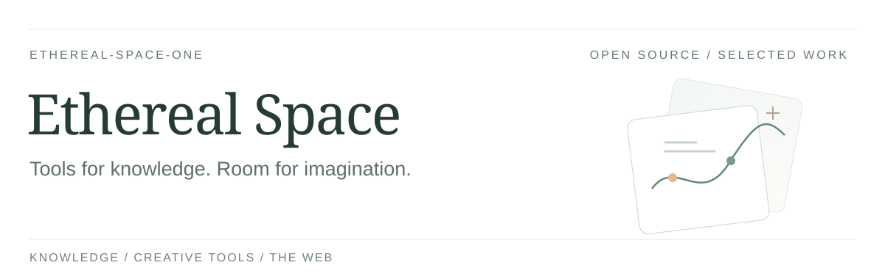
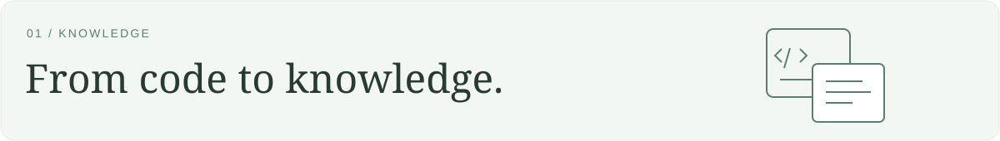
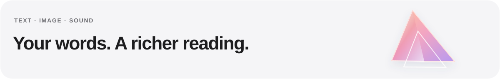

<a href="README.md">English</a> · <strong>简体中文</strong>

我在构建关于**知识、创造力与个人互联网**的开放工具。

探索 AI 如何帮助我们理解代码、看见故事，以及带着自己的方向使用网络。

 

## 开源作品

### [code2kb-agent-toolkit](https://github.com/Ethereal-Space-one/code2kb-agent-toolkit)

与你现有的 AI 编码助手协作，将源码中的业务规则整理成**有依据、可维护的知识**。

[了解工具包 ↗](https://github.com/Ethereal-Space-one/code2kb-agent-toolkit) · [快速开始](https://github.com/Ethereal-Space-one/code2kb-agent-toolkit#快速开始)

 

### [Taleprism](https://github.com/Ethereal-Space-one/taleprism)

**保留小说原文**，让人物与场景共同构成连续的图文阅读体验。目前为公开试用版。

[阅读《赤壁》示例 ↗](https://ethereal-space-one.github.io/taleprism/) · [了解项目](https://github.com/Ethereal-Space-one/taleprism)

 

### [Grid Browser](https://github.com/Ethereal-Space-one/grid-browser)

从用户意图出发，探索如何更好地**找到、理解并使用真实网页**，同时由人掌控方向。目前为实验项目，尚不适合日常使用。

[了解实验 ↗](https://github.com/Ethereal-Space-one/grid-browser) · [产品方向](https://github.com/Ethereal-Space-one/grid-browser/blob/main/PLAN.md)

 

## 关注方向

**有据可循的知识** · **视觉叙事** · **人机协作**

欢迎通过相应项目的仓库交流问题、想法与反馈。
