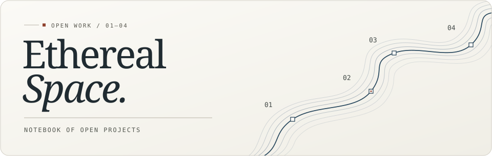
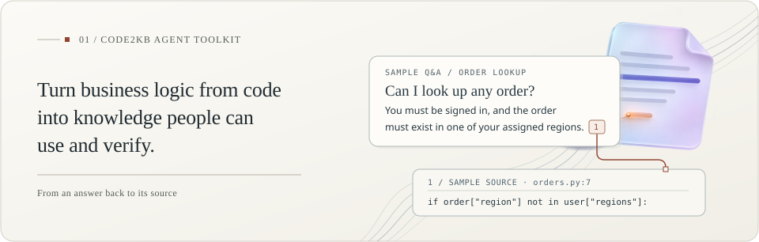
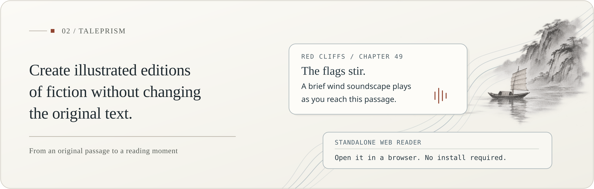
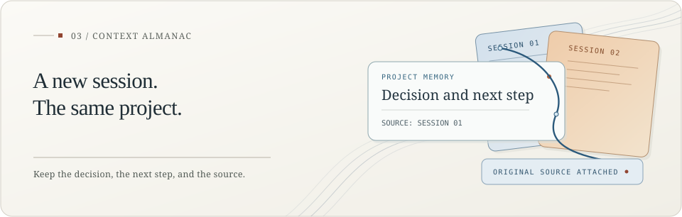

<a href="README.md">English</a> · <strong>简体中文</strong>

# 精选作品

从代码里读出业务规则，从小说里听见那一幕的声音，也让项目记忆跟得上一次次 AI 会话。

## 01 · [Code2KB Agent Toolkit](https://github.com/Ethereal-Space-one/code2kb-agent-toolkit)

**把从源码中提取的业务逻辑，整理成可供机器人问答、也能回到源码核对的知识。** 编码助手负责提取和写作；Code2KB 检查证据与审核状态，再生成交付物。搜索索引和机器人部署仍由你决定。

[看一份订单问答示例（英文）](https://github.com/Ethereal-Space-one/code2kb-agent-toolkit/blob/62f3012dc5380918efec38e4114e24e231a6e211/conformance/english/knowledge.md) · [查看工具包](https://github.com/Ethereal-Space-one/code2kb-agent-toolkit) · [快速上手（英文）](https://github.com/Ethereal-Space-one/code2kb-agent-toolkit/blob/main/README.en.md#quick-start) · [v2.4.1 发布记录](https://github.com/Ethereal-Space-one/code2kb-agent-toolkit/releases/tag/v2.4.1)

## 02 · [Taleprism](https://github.com/Ethereal-Space-one/taleprism)

**原文一字不改，让读到的那一幕有自己的声音。** Taleprism 是本地制作台，也是一种不必安装的读本。地图和人物阵营随进度展开，图、短声景和局部动效只落在适合的段落。《赤壁》读到旗动能听见风，《留门》则把雨和经过巷口的车留在同一小段里。

[在线读《赤壁》](https://ethereal-space-one.github.io/taleprism/) · [下载《留门》读本](https://github.com/Ethereal-Space-one/taleprism/releases/download/v0.9.2/taleprism-v0.9.2-the-door-left-open-reader.zip) · [查看项目](https://github.com/Ethereal-Space-one/taleprism)

## 03 · Context Almanac

**为跨 AI 会话的项目建一份个人知识库。** Context Almanac 把同一项目的对话归到一起，留下做过的决定、下一步和原始出处。换个会话，不用再靠一段旧摘要猜项目做到哪了。

*私有试用中 · 暂无公开下载。*

### 工作台上的其他项目

<table width="100%">
<tr>
<td width="50%" valign="top">

<strong>04 · <a href="https://github.com/Ethereal-Space-one/grid-browser">Grid Browser</a></strong> 
在原页之间比对资料，保存带出处的判断。 
<a href="https://github.com/Ethereal-Space-one/grid-browser/blob/release/v0.2.1/docs/TRY_GRID_0.2.1.md">预览指南</a> · <a href="https://github.com/Ethereal-Space-one/grid-browser/blob/main/PLAN.md">产品方向</a>
</td>
<td width="50%" valign="top">

<strong>05 · <a href="https://github.com/Ethereal-Space-one/long-task-runbook">Long Task Runbook</a></strong> 
交接长任务，从核验过的检查点继续。 
<a href="https://github.com/Ethereal-Space-one/long-task-runbook/blob/main/skills/long-task-runbook/SKILL.md">阅读 Skill</a> · <a href="https://github.com/Ethereal-Space-one/long-task-runbook/releases/latest">下载</a>
</td>
</tr>
</table>

[全部公开仓库](https://github.com/Ethereal-Space-one?tab=repositories) · [本页源码](https://github.com/Ethereal-Space-one/Ethereal-Space-one)
