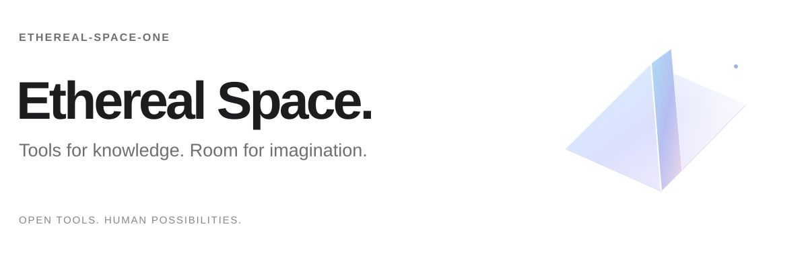
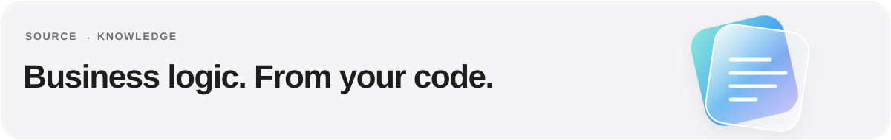

<a href="README.md">English</a> · <strong>简体中文</strong>

我在构建关于**知识、创造力与个人互联网**的开放工具。

探索 AI 如何帮助我们理解代码、看见故事，以及带着自己的方向使用网络。

 

## 开源作品

### [code2kb-agent-toolkit](https://github.com/Ethereal-Space-one/code2kb-agent-toolkit)

交给现有 AI 编码助手的工具包，将**从源码中提取的业务逻辑整理成有证据、可供机器人检索的知识**。

**工作流程。** AI 负责取证与写作，CLI 检查证据记录、审核状态并生成发布文件；检索索引和机器人部署由使用方接入。

[了解工具包](https://github.com/Ethereal-Space-one/code2kb-agent-toolkit) · [快速开始](https://github.com/Ethereal-Space-one/code2kb-agent-toolkit#快速开始)

 

### [Taleprism](https://github.com/Ethereal-Space-one/taleprism)

面向图文小说的**提示词工作流与本地制作台**，保留原文，协调人物、场景与可选声音，构建连续的阅读体验。

**公开试用。** 面向单章与短篇：在自己的工具中生成图片，审校连续性，再导出独立阅读器。

[阅读《赤壁》示例](https://ethereal-space-one.github.io/taleprism/) · [了解项目](https://github.com/Ethereal-Space-one/taleprism)

 

### [Grid Browser](https://github.com/Ethereal-Space-one/grid-browser)

以**用户意图而非推荐流为出发点**的开源浏览器项目，愿景是让你选择的 Agent 进入同一个真实浏览会话，由你掌控方向。

**原型阶段。** 当前 Electron 原型支持搜索、网页阅读和获授权的 MCP 只读接入；Agent 操作与接管仍在规划中，尚不适合日常使用。

[了解实验](https://github.com/Ethereal-Space-one/grid-browser) · [产品方向](https://github.com/Ethereal-Space-one/grid-browser/blob/main/PLAN.md)

 

## 关注方向

**有据可循的知识** · **视觉叙事** · **人机协作**

欢迎通过相应项目的仓库交流问题、想法与反馈。
